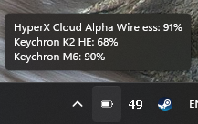
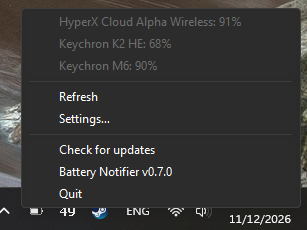
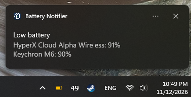
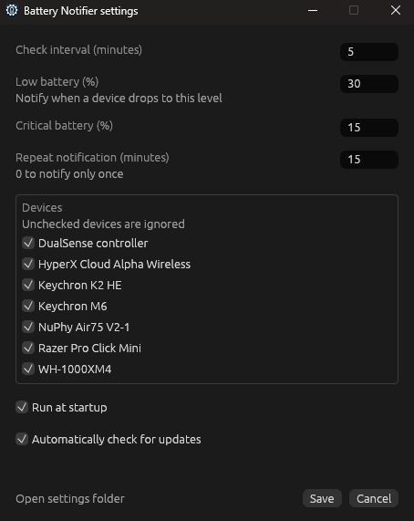

# battery-notifier

## About

A tray app for Windows and macOS that watches the battery of your wireless devices: mice, keyboards, headsets and controllers over their USB receiver, and Bluetooth devices on Windows.

- The tray icon shows the lowest battery level, following the taskbar theme, amber when low and red when critical.
- Hover the icon or right-click it to see the level of each device. Left-click it to check right away.
- A notification shows when a device runs low, and repeats while it stays low (configurable).

| Tray icon                                                   | Menu                                    | Notification                                              |
| ----------------------------------------------------------- | --------------------------------------- | --------------------------------------------------------- |
|  |  |  |

## Install

Download the file for your OS from the [latest release](https://github.com/ldkv/battery-notify/releases/latest):

| File                                              | For                                        |
| ------------------------------------------------- | ------------------------------------------ |
| `battery_notifier_rust-<version>-windows-x64.zip` | Windows                                    |
| `battery_notifier_rust-<version>-macos.zip`       | macOS 11 or later, Apple Silicon and Intel |
| `SHA256SUMS.txt`                                  | Checksums of the release's files           |

### Verify a download

Optionally, the hash of a file must match the one in `SHA256SUMS.txt`:

```powershell
certutil -hashfile <file> SHA256   # Windows
shasum -a 256 <file>               # macOS
```

The build provenance can also be verified with the GitHub CLI:

```powershell
gh attestation verify <file> --repo ldkv/battery-notify
```

### Windows

Unzip the file and keep `battery_notifier_rust-<version>.exe` in a folder you can write to, e.g. `%LOCALAPPDATA%\Programs\BatteryNotifier`: each update puts the new version next to it, under its own name, and deletes the old one. Run at startup follows the new file, but shortcuts to the old one stop working.

Run the executable. It is not code-signed, so Windows SmartScreen may warn about an unknown publisher: click **More info** → **Run anyway**.

The app runs in the system tray.

### macOS

1. Unzip the file and move `Battery Notifier.app` to Applications: macOS only allows notifications from an app in Applications or `~/Applications`.
2. The app is not notarized by Apple, so macOS blocks its first launch. Open it once, then allow it in **System Settings** → **Privacy & Security** → **Open Anyway**. Alternatively, clear the download's quarantine flag from a terminal: `xattr -dr com.apple.quarantine "/Applications/Battery Notifier.app"`.
3. Allow notifications when asked.

The app lives in the menu bar, without a Dock icon. Bluetooth devices are only supported on Windows.

### Updates

The app checks for a new release when it starts and then once a day, unless **Automatically check for updates** is off in the settings; **Check for updates** in the menu checks right away. When one is out, a notification says so and the menu shows **Update to <version>**: click it to download, verify and install it, and the app restarts. If the update cannot be installed, e.g. when the app's folder is not writable, the release page opens to download it by hand.

### Linux: run from source

There is no release for Linux, which is untested. Build it from source, see [CONTRIBUTING.md](CONTRIBUTING.md).

## Settings

Right-click the tray icon → **Settings…** to open the settings.

<p align="center">
  
</p>

Settings are saved to `config.toml` and logs to `Logs/battery_notifier_rust.<date>.log`, both in the settings folder (**Open settings folder** in the settings dialog): `%LOCALAPPDATA%\battery-notifier` on Windows, `~/Library/Application Support/battery-notifier` on macOS and `~/.config/battery-notifier` on Linux.

The dialog can also be opened from a terminal with `battery-notifier settings`.

## Supported devices

- Razer Pro Click Mini
- HyperX Cloud Alpha Wireless
- DualSense controller
- Keychron K2 HE via the 2.4 GHz receiver, with custom firmware: see [docs/keychron-k2-he.md](docs/keychron-k2-he.md)
- Keychron M6 8K via the 2.4 GHz receiver Keychron Ultra-Link 8K, tested on Windows: see [docs/keychron-m6.md](docs/keychron-m6.md)
- Bluetooth devices with battery level on Windows

### Trying another model

A model that is not listed may answer the battery request of a supported one, e.g. another mouse from the same manufacturer. To try it, create `extra-devices.toml` in the settings folder:

```toml
[[devices]]
name = "Keychron M7"      # shown in the tray and the settings
same_as = "Keychron M6"   # supported device whose battery request to send
pid = 0xD029              # optional: vid, pid, usage_page, usage, interface, default to same_as's
```

The file is read on each check, and on **Refresh**. Invalid entries are skipped and logged. If the model reports its battery level, please open an issue so it can be added to the list.

## Development

See [CONTRIBUTING.md](CONTRIBUTING.md) to build, run and test the app.
